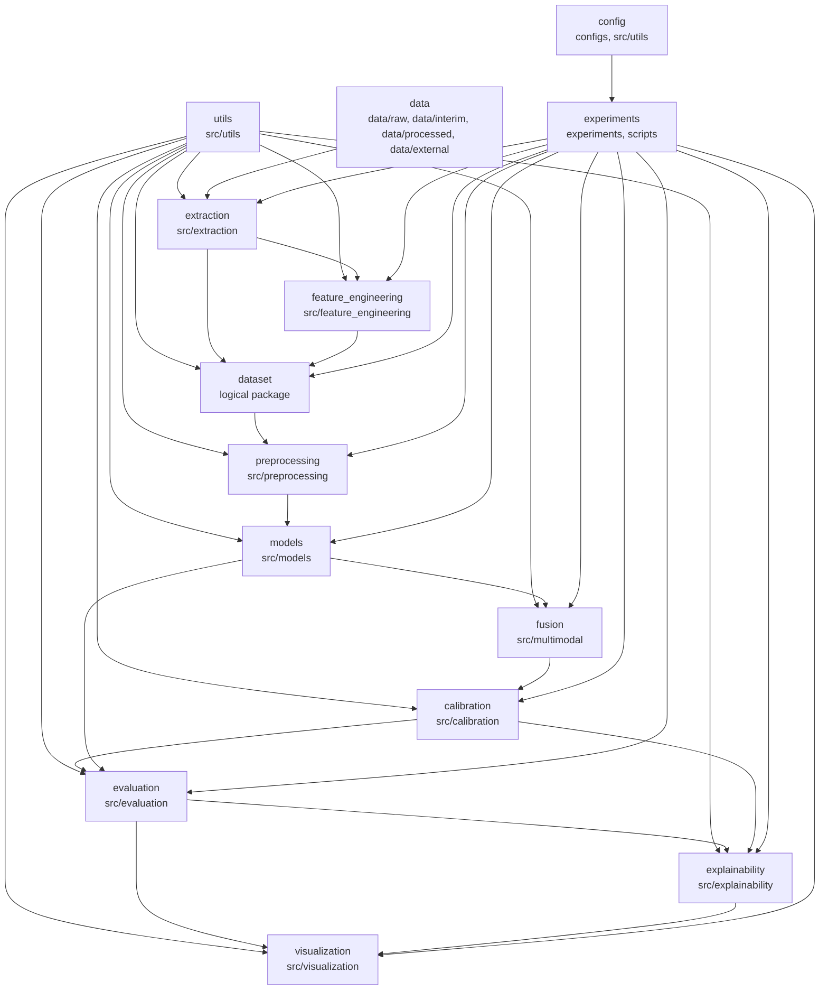
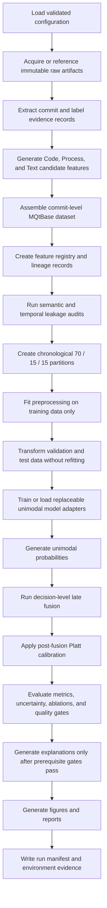
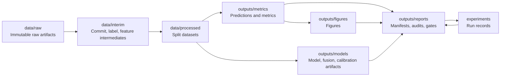
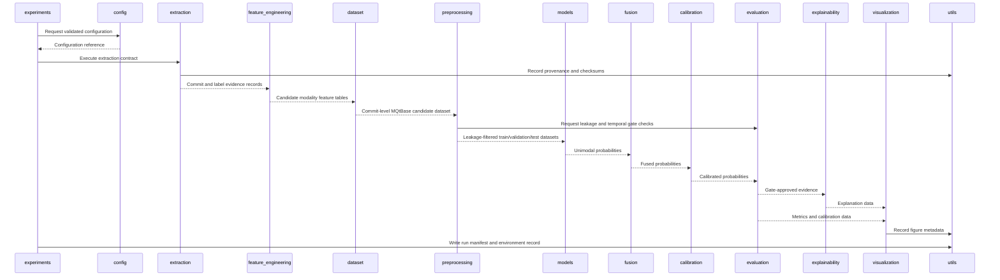

# MMSDP-XAI Implementation Architecture

Version: 1.0  
Status: Draft implementation architecture  
Primary source of truth: `docs/PROJECT_CONTEXT.md` Version 2.0

## 1. Purpose

This document bridges MMSDP-XAI project governance and future software implementation.

It defines package boundaries, responsibilities, interfaces, data contracts, execution order, artifacts, dependency rules, testing expectations, and extension points for the clean MMSDP-XAI project.

This document defines architecture only. It does not define Python code, machine-learning implementations, completed algorithms, final repository statistics, final dataset statistics, or experimental results. Any unresolved implementation detail is marked as `Pending Decision`.

## 2. Scope

In scope:

- Logical Python package architecture.
- Repository-relative mapping from governance packages to project paths.
- Module responsibilities and replaceable interfaces.
- Data and artifact contracts between packages.
- Pipeline execution order.
- Configuration, logging, experiment tracking, dependency, error-handling, and testing strategies.
- Extension points for models, fusion, calibration, explainability, evaluation metrics, and visualizations.

Out of scope:

- Concrete Python classes or functions.
- Machine-learning library selection.
- Hyperparameters.
- Final feature lists, feature counts, embeddings, or dataset statistics.
- Completed implementation status.
- Experimental results.

## 3. Relationship with Governance Documents

`docs/PROJECT_CONTEXT.md` Version 2.0 remains the Single Source of Truth for scientific scope, frozen research decisions, and project terminology.

| Governance Document | Architectural Use |
| --- | --- |
| `docs/PROJECT_CONTEXT.md` | Primary authority for MQtBase, QtBase, commit-level analysis, Code/Process/Text modalities, chronological validation, late fusion, Platt Scaling, SHAP-based explainability, and leakage controls. |
| `docs/SYSTEM_ARCHITECTURE.md` | System-level layers, data flow, high-level components, and architecture constraints. |
| `docs/DATASET_SPECIFICATION.md` | Dataset lifecycle, data contracts, lineage, validation, partitioning, and governance. |
| `docs/FEATURE_SPECIFICATION.md` | Feature categories, feature registry, leakage classification, forbidden variables, and feature lifecycle. |
| `docs/DESIGN_DECISIONS.md` | Decision IDs used for traceability from implementation architecture to governance. |
| `docs/QUALITY_REQUIREMENTS.md` | Measurable software and methodological requirements. |
| `docs/RISK_REGISTER.md` | Implementation and methodological risks to control. |
| `docs/EXPERIMENT_QUALITY_GATES.md` | Gates that block or condition artifact acceptance. |

## 4. Repository Mapping

The mandatory implementation architecture is expressed as logical packages. The current repository scaffold stores production Python code under `src/`. This document maps each logical package to its repository-relative location without creating files or changing the repository.

| Logical Package | Repository Path | Notes |
| --- | --- | --- |
| `config/` | `configs/`, `src/utils/` | Configuration files live in `configs/`; configuration loading utilities are planned under `src/utils/`. Exact implementation path is `Pending Decision`. |
| `data/` | `data/raw/`, `data/interim/`, `data/processed/`, `data/external/` | Data artifact storage, not production Python code. |
| `extraction/` | `src/extraction/` | Source extraction and commit/issue acquisition. |
| `preprocessing/` | `src/preprocessing/` | Leakage-safe cleaning, partitioning, and train-only transformations. |
| `feature_engineering/` | `src/feature_engineering/` | Code, process, and text feature generation. |
| `dataset/` | `src/preprocessing/`, `data/processed/` | Dataset assembly and validation are logically separate; exact package path is `Pending Decision`. |
| `models/` | `src/models/` | Replaceable unimodal model interfaces and training support. |
| `fusion/` | `src/multimodal/` | Decision-level late fusion; current scaffold uses `multimodal`. |
| `calibration/` | `src/calibration/` | Post-fusion Platt Scaling and calibration interfaces. |
| `explainability/` | `src/explainability/` | Global, local, and counterfactual explanation interfaces. |
| `evaluation/` | `src/evaluation/` | Discrimination, calibration, statistical, plausibility, and ablation evaluation. |
| `experiments/` | `experiments/`, `scripts/` | Experiment definitions, orchestration, and run records. |
| `utils/` | `src/utils/` | Shared logging, path, manifest, validation, and reproducibility utilities. |
| `visualization/` | `src/visualization/` | Figures and visual reporting support. |

## 5. Package Architecture

The implementation architecture follows layered dependencies. Lower layers must not depend on higher layers.

## 6. Python Module Inventory

The following inventory defines planned module responsibilities only. No module implementation is claimed.

| Logical Package | Planned Module Area | Repository Path | Status |
| --- | --- | --- | --- |
| `config/` | Configuration loading, validation, and path resolution. | `configs/`, `src/utils/` | Pending Decision |
| `extraction/` | QtBase commit extraction, issue-link extraction, raw manifest generation. | `src/extraction/` | Pending Decision |
| `feature_engineering/` | Code, process, and text feature generation. | `src/feature_engineering/` | Pending Decision |
| `dataset/` | Dataset assembly, schema validation, lineage, and split manifest generation. | `src/preprocessing/` or Pending Decision | Pending Decision |
| `preprocessing/` | Missing-value handling, train-only fitting, transformations, leakage filtering. | `src/preprocessing/` | Pending Decision |
| `models/` | Replaceable unimodal model adapters for Code, Process, and Text. | `src/models/` | Pending Decision |
| `fusion/` | Replaceable decision-level late-fusion adapters. | `src/multimodal/` | Pending Decision |
| `calibration/` | Replaceable calibration adapters with Platt Scaling as approved baseline. | `src/calibration/` | Pending Decision |
| `explainability/` | Replaceable global, local, and counterfactual explanation adapters. | `src/explainability/` | Pending Decision |
| `evaluation/` | Metrics, ablations, calibration checks, statistical validation, plausibility gates. | `src/evaluation/` | Pending Decision |
| `experiments/` | Experiment orchestration, manifests, run directories, and reproducibility records. | `experiments/`, `scripts/` | Pending Decision |
| `utils/` | Logging, manifests, checksums, validation helpers, constants, and environment capture. | `src/utils/` | Pending Decision |
| `visualization/` | Plot generation from metrics, explanations, and reports. | `src/visualization/` | Pending Decision |

## 7. Package Responsibilities

| Package | Purpose | Responsibilities | Inputs | Outputs | Public Interface | Produced Artifacts | Dependencies | Downstream Consumers | Related Design Decisions | Related Quality Requirements | Related Risks | Related Quality Gates |
| --- | --- | --- | --- | --- | --- | --- | --- | --- | --- | --- | --- | --- |
| `config/` | Provide validated configuration and path settings. | Load configuration, validate required fields, expose read-only runtime settings, record configuration version. | `configs/`, command or experiment inputs. | Configuration object or manifest reference. | Configuration provider interface. | Configuration manifest. | `utils/` | All packages. | DD-001, DD-019 | QR-023, QR-024 | RK-018, RK-019 | G16, G18 |
| `data/` | Store lifecycle artifacts. | Preserve raw, interim, processed, and external artifacts according to lifecycle rules. | QtBase artifacts, issue artifacts, generated datasets. | Raw, interim, processed, and external files. | Data location contract. | Dataset artifacts and checksums. | None | `extraction/`, `dataset/`, `preprocessing/`, `experiments/` | DD-003, DD-017 | QR-001, QR-002 | RK-005, RK-018 | G1, G16 |
| `extraction/` | Acquire source data and produce commit-level raw records. | Extract commit metadata, diffs, file changes, and label evidence sources; preserve traceability. | `data/raw/`, `data/external/`, configuration. | Commit records, issue-link records, raw manifests. | Extractor interface. | Repository snapshot report, raw acquisition manifest. | `config/`, `utils/`, `data/` | `feature_engineering/`, `dataset/` | DD-002, DD-003, DD-017 | QR-001, QR-002, QR-003, QR-004 | RK-005, RK-006, RK-018 | G1, G2 |
| `feature_engineering/` | Produce candidate Code, Process, and Text feature tables. | Generate feature candidates, attach modality and lineage metadata, preserve commit-level keys. | Commit records, diffs, text artifacts, configuration. | Candidate feature tables and feature inventory inputs. | Feature generator interface. | Feature inventory draft, modality feature artifacts. | `config/`, `utils/`, `extraction/` | `dataset/`, `preprocessing/`, `evaluation/` | DD-004, DD-005 | QR-005, QR-006, QR-007 | RK-001, RK-002, RK-003, RK-008 | G3, G4, G5 |
| `dataset/` | Assemble and validate MQtBase commit-level dataset artifacts. | Join labels and modality features, validate schemas, record lineage, create dataset manifests. | Feature tables, labels, commit records. | Candidate and processed dataset artifacts. | Dataset builder and validator interface. | Dataset manifest, lineage report, split manifest. | `config/`, `utils/`, `data/`, `extraction/`, `feature_engineering/` | `preprocessing/`, `models/`, `experiments/` | DD-002, DD-003, DD-006 | QR-001, QR-003, QR-004, QR-005 | RK-005, RK-006, RK-007, RK-008 | G1, G2, G3 |
| `preprocessing/` | Apply leakage-safe and train-only transformations. | Filter forbidden variables, split chronologically, fit transformations on training data only, apply transformations to validation/test. | Candidate dataset, feature registry, split policy. | Preprocessed train/validation/test datasets and preprocessing metadata. | Preprocessor interface. | Preprocessing manifest, leakage report, transformed datasets. | `config/`, `utils/`, `dataset/` | `models/`, `fusion/`, `evaluation/` | DD-005, DD-006, DD-007, DD-018 | QR-006, QR-007, QR-008, QR-009, QR-010, QR-011 | RK-001, RK-002, RK-003, RK-018 | G4, G5, G6 |
| `models/` | Train and apply replaceable unimodal models. | Provide model-agnostic adapters for Code, Process, and Text predictors; emit probabilities and model metadata. | Preprocessed modality datasets, configuration. | Unimodal predictions and model artifacts. | Model adapter interface. | Model artifact, prediction manifest, model metadata. | `config/`, `utils/`, `preprocessing/` | `fusion/`, `evaluation/`, `explainability/` | DD-009, DD-015, DD-019 | QR-012, QR-023, QR-028 | RK-009, RK-010, RK-012 | G7, G13, G16 |
| `fusion/` | Implement replaceable decision-level late fusion. | Consume unimodal probabilities, enforce leakage-safe out-of-fold or temporal stacking design, emit fused probabilities. | Code, Process, and Text unimodal probabilities. | Fused raw probabilities and fusion metadata. | Fusion adapter interface. | Fusion input manifest, fusion artifact, fused prediction file. | `config/`, `utils/`, `models/` | `calibration/`, `evaluation/` | DD-010 | QR-014, QR-015 | RK-010, RK-013 | G9 |
| `calibration/` | Calibrate fused probabilities. | Apply replaceable calibration interface with post-fusion Platt Scaling as approved architecture. | Fused validation and test probabilities, labels as permitted by protocol. | Calibrated probabilities and calibration metadata. | Calibrator interface. | Calibrator artifact, calibration manifest. | `config/`, `utils/`, `fusion/` | `evaluation/`, `explainability/`, `visualization/` | DD-012, DD-013 | QR-018, QR-019 | RK-014 | G12 |
| `explainability/` | Produce valid global, local, and counterfactual explanations after required gates pass. | Validate gate prerequisites, generate explanation artifacts through replaceable explainability modules. | Approved models, features, predictions, calibration/evaluation evidence. | Explanation records, reports, and figure inputs. | Explainer interface. | Explanation report, explanation data, explanation metadata. | `config/`, `utils/`, `models/`, `calibration/`, `evaluation/` | `visualization/`, `outputs/reports/` | DD-014 | QR-022 | RK-015 | G15 |
| `evaluation/` | Evaluate discrimination, calibration, ablation, uncertainty, plausibility, and quality gates. | Compute approved metrics, run gate checks, record evidence, reject invalid results. | Predictions, labels, manifests, feature registry, configurations. | Metrics, gate reports, ablation reports, plausibility reports. | Evaluator and quality gate interface. | Metrics files, statistical validation report, gate evidence. | `config/`, `utils/`, `models/`, `fusion/`, `calibration/` | `experiments/`, `visualization/`, `explainability/` | DD-011, DD-013, DD-014, DD-021 | QR-016, QR-017, QR-018, QR-019, QR-020, QR-021, QR-022 | RK-004, RK-014, RK-015, RK-016, RK-017 | G10, G11, G12, G13, G14, G15 |
| `experiments/` | Orchestrate reproducible pipeline execution. | Bind configurations, execute pipeline stages, preserve seed/config/logs/metrics/environment/artifacts. | Configuration, dataset version, feature registry, pipeline plan. | Complete experiment run directory and manifest. | Experiment runner interface. | Run manifest, logs, environment manifest, artifact index. | All packages through public interfaces. | `outputs/`, thesis and paper analysis. | DD-019, DD-021 | QR-023, QR-024, QR-025, QR-030 | RK-018, RK-019 | G16, G18 |
| `utils/` | Provide shared cross-cutting utilities. | Logging, path handling, manifests, checksums, validation helpers, environment capture, reproducibility support. | Package requests and runtime settings. | Utility outputs and shared manifests. | Utility service interfaces. | Checksums, environment records, logs. | `config/` where applicable | All packages. | DD-019 | QR-023, QR-024 | RK-018 | G16 |
| `visualization/` | Generate figures from approved evidence. | Produce metric, calibration, explainability, and reporting figures without changing scientific claims. | Metrics, explanations, calibration outputs, configuration. | Figures and figure metadata. | Visualization renderer interface. | Files under `outputs/figures/`. | `config/`, `utils/`, `evaluation/`, `explainability/` | `outputs/reports/`, paper and thesis artifacts. | DD-013, DD-014, DD-021 | QR-018, QR-022, QR-030 | RK-015, RK-019 | G12, G15, G18 |

## 8. Module Interfaces

### Scientific Dataset Construction phase

Sprint 10.8.2.1 defines a project-independent construction architecture under
`src/dataset/`. Its deterministic stage order is repository acquisition, raw
artifact extraction, target-evidence construction, candidate construction,
target assignment, feature construction, feature-provenance audit, leakage
validation, dataset assembly, manifest generation, and validation reporting.

Target evidence and defect-inducing candidates are audit provenance only.
Candidate construction is a separate stage before target assignment, which is
validated against the official `ScientificTargetContract`; predictors are
constructed through a label-blind protected context. Feature
Construction receives only the immutable ordered observation identifiers
derived from target assignments for alignment; target fields, labels,
rationales, evidence identifiers, target-evidence records, candidate records,
attributions, exclusions, validations, bindings, and both audit artifact roles
are structurally unavailable. Feature eligibility is
determined from the scientific provenance inventory and temporal-availability
controls, not from feature names alone.

Repository snapshots store a resolved complete lowercase Git commit identifier
(40-character SHA-1 or 64-character SHA-256), never an unresolved branch or tag.
Target-evidence and defect-inducing-candidate artifacts remain source-artifact
provenance for reproducibility and target audit, but cannot back feature
provenance or values. Inventory-level
metadata is descriptive and excluded from inventory identity, while metadata on
individual feature-provenance records remains digest-bearing when it records
temporal, fit-scope, linkage, or other scientific controls.

Each stage has one replaceable, project-independent handler.

### Qt Base repository acquisition adapter

Qt Base is the first concrete project-specific repository adapter. Its
scientific identity uses the official canonical repository URL
`https://code.qt.io/qt/qtbase.git`. The adapter resolves a caller-supplied
mutable branch or tag, or a supplied commit reference, to a full immutable Git
commit identifier. The snapshot stores that resolved commit rather than the
branch or unresolved tag. Repository identity and artifact digests exclude
local paths, runtime timestamps, durations, and machine identity.

Sprint 10.8.2.2 implements repository acquisition and snapshot validation only.
It does not extract commits, diffs, files, issues, labels, targets, features, or
datasets, and it does not run models or experiments.

Interfaces must be stable contracts between packages, not library-specific implementations.

| Interface | Provider | Consumers | Contract Summary | Status |
| --- | --- | --- | --- | --- |
| Configuration provider | `config/` | All packages | Provides validated configuration, path references, seed references, and version identifiers. | Pending Decision |
| Extractor | `extraction/` | `feature_engineering/`, `dataset/` | Produces commit-level source records with traceability metadata. | Pending Decision |
| Feature generator | `feature_engineering/` | `dataset/`, `preprocessing/` | Produces candidate feature tables with modality and lineage metadata. | Pending Decision |
| Dataset builder | `dataset/` | `preprocessing/`, `experiments/` | Produces commit-level MQtBase dataset artifacts and manifests. | Pending Decision |
| Preprocessor | `preprocessing/` | `models/`, `fusion/`, `evaluation/` | Produces leakage-filtered, split-aware, train-only transformed datasets. | Pending Decision |
| Model adapter | `models/` | `fusion/`, `evaluation/`, `explainability/` | Trains or loads replaceable unimodal model components and emits probabilities. | Pending Decision |
| Fusion adapter | `fusion/` | `calibration/`, `evaluation/` | Produces decision-level late-fusion probabilities from unimodal predictions. | Pending Decision |
| Calibrator | `calibration/` | `evaluation/`, `explainability/`, `visualization/` | Calibrates fused probabilities using the approved calibration protocol. | Pending Decision |
| Evaluator | `evaluation/` | `experiments/`, `visualization/`, `explainability/` | Computes metrics, gates, ablations, plausibility checks, and uncertainty evidence. | Pending Decision |
| Explainer | `explainability/` | `visualization/`, `outputs/reports/` | Produces global, local, and counterfactual explanations after gate prerequisites pass. | Pending Decision |
| Visualization renderer | `visualization/` | `outputs/`, manuscript preparation | Produces figure artifacts from approved evidence. | Pending Decision |
| Manifest service | `utils/` | All packages | Records configuration, environment, checksums, artifacts, and lineage. | Pending Decision |

## 9. Data Contracts

Data contracts are repository-level agreements between packages.

| Contract | Producer | Consumer | Required Fields or Properties | Artifact Location | Status |
| --- | --- | --- | --- | --- | --- |
| Raw source contract | `data/`, `extraction/` | `extraction/` | QtBase snapshot identity, acquisition manifest, raw artifact checksums. | `data/raw/`, `data/external/` | Pending Decision |
| Commit record contract | `extraction/` | `feature_engineering/`, `dataset/` | Commit-level key, timestamp, source snapshot reference, traceability metadata. | `data/interim/` | Pending Decision |
| Label contract | `extraction/`, `dataset/` | `dataset/`, `preprocessing/` | Target label, label rule, label source, ambiguity status, no predictor leakage. | `data/interim/`, `outputs/reports/` | Pending Decision |
| Feature table contract | `feature_engineering/` | `dataset/`, `preprocessing/` | Feature ID, modality, commit key, derivation, prediction-time availability, leakage status. | `data/interim/`, `outputs/reports/` | Pending Decision |
| Feature registry contract | `feature_engineering/`, `preprocessing/` | `preprocessing/`, `evaluation/`, `experiments/` | Feature state, eligibility, missing-value policy, validation rule, traceability IDs. | `outputs/reports/` | Pending Decision |
| Processed dataset contract | `dataset/`, `preprocessing/` | `models/`, `fusion/`, `evaluation/` | Train/validation/test split, approved predictors, labels, traceability metadata. | `data/processed/` | Pending Decision |
| Prediction contract | `models/`, `fusion/`, `calibration/` | `evaluation/`, `explainability/` | Commit key, split, model or fusion ID, probability, dataset version, configuration ID. | `outputs/metrics/` or `outputs/reports/` | Pending Decision |
| Metrics contract | `evaluation/` | `experiments/`, `visualization/`, paper/thesis analysis | Metric name, split, value, uncertainty when applicable, configuration ID, dataset version. | `outputs/metrics/` | Pending Decision |
| Explanation contract | `explainability/` | `visualization/`, `outputs/reports/` | Commit key or global scope, explanation method, feature references, prerequisite gate status. | `outputs/reports/`, `outputs/figures/` | Pending Decision |
| Run manifest contract | `experiments/`, `utils/` | Governance and reproducibility review | Configuration, seed, dataset version, feature registry, logs, metrics, environment, artifacts. | `experiments/`, `outputs/reports/` | Pending Decision |

## 10. Pipeline Execution Order

The pipeline order must preserve raw-data immutability, leakage prevention, train-only preprocessing, chronological validation, and reproducibility.

## 11. Artifact Production

| Artifact | Producer | Location | Required Governance Link |
| --- | --- | --- | --- |
| Repository snapshot report | `extraction/` | `outputs/reports/` | QR-001, QR-002, G1 |
| Raw acquisition manifest | `extraction/`, `utils/` | `data/raw/` or `outputs/reports/` | DD-017, QR-001 |
| Feature inventory | `feature_engineering/`, `preprocessing/` | `outputs/reports/` | QR-005, G3 |
| Leakage report | `preprocessing/`, `evaluation/` | `outputs/reports/` | QR-006, QR-007, QR-008, G4, G5 |
| Split manifest | `dataset/`, `preprocessing/` | `data/processed/` or `outputs/reports/` | DD-007, QR-011, G5 |
| Preprocessing manifest | `preprocessing/` | `outputs/reports/` | DD-018, QR-010, G6 |
| Model artifacts | `models/` | `outputs/models/` | QR-012, QR-023 |
| Fusion input manifest | `fusion/` | `outputs/reports/` | QR-014, QR-015, G9 |
| Calibration report | `calibration/`, `evaluation/` | `outputs/reports/`, `outputs/metrics/` | QR-018, QR-019, G12 |
| Ablation reports | `evaluation/` | `outputs/reports/`, `outputs/metrics/` | QR-016, QR-017, G10, G11 |
| Explainability report | `explainability/` | `outputs/reports/` | QR-022, G15 |
| Run manifest | `experiments/`, `utils/` | `experiments/`, `outputs/reports/` | DD-019, QR-023, G16 |

## 12. Configuration Strategy

Configuration must be explicit, versioned, and reproducible.

| Configuration Area | Requirement |
| --- | --- |
| Dataset configuration | Must identify dataset version, source snapshot, paths, and split policy. |
| Feature configuration | Must identify feature registry version and enabled feature groups. |
| Preprocessing configuration | Must identify train-only fitted transformations and missing-value policies. |
| Model configuration | Must identify model adapter, modality, seed, and model-specific settings without binding architecture to a single library. |
| Fusion configuration | Must identify late-fusion adapter and out-of-fold or temporal stacking protocol. |
| Calibration configuration | Must identify post-fusion Platt Scaling protocol and validation-fit policy. |
| Evaluation configuration | Must identify metrics, ablations, uncertainty protocol, and plausibility checks. |
| Explainability configuration | Must identify explanation adapters and prerequisite gate evidence. |
| Environment configuration | Must capture Python version, package versions, OS/runtime context, and relevant hardware when used. |

Exact configuration file format is `Pending Decision`.

## 13. Logging Strategy

Logging must support reproducibility, debugging, and auditability without embedding scientific claims.

| Log Type | Purpose | Required Content | Location |
| --- | --- | --- | --- |
| Pipeline log | Stage-level execution trace. | Stage name, start/end time, status, configuration ID, dataset version. | `outputs/reports/` or `experiments/` |
| Validation log | Dataset, feature, leakage, and split validation evidence. | Gate ID, check name, pass/fail status, evidence artifact path. | `outputs/reports/` |
| Error log | Failure diagnosis. | Exception category, package, affected artifact, recovery guidance. | `outputs/reports/` or `experiments/` |
| Reproducibility log | Run reconstruction support. | Seed, environment, artifact checksums, configuration references. | `experiments/` or `outputs/reports/` |

Exact logging format is `Pending Decision`.

## 14. Experiment Tracking

Experiment tracking must preserve enough evidence to reconstruct accepted runs.

Each run must record:

- Run identifier.
- Configuration version.
- Dataset version.
- Feature registry version.
- Chronological split manifest.
- Random seed when applicable.
- Environment manifest.
- Package or code version reference.
- Model, fusion, calibration, evaluation, and explanation artifact references.
- Metrics and quality gate outcomes.
- Logs and error records.

Experiment tracking location and file format are `Pending Decision`.

## 15. Dependency Rules

Dependencies must favor loose coupling and high cohesion.

| Rule ID | Dependency Rule |
| --- | --- |
| DEP-001 | Packages communicate through documented interfaces and data contracts. |
| DEP-002 | Model, fusion, calibration, explainability, and evaluation implementations must be replaceable behind adapters. |
| DEP-003 | Lower-level packages must not depend on higher-level experiment orchestration. |
| DEP-004 | `models/` must not depend on concrete fusion, calibration, explainability, or visualization implementations. |
| DEP-005 | `feature_engineering/` must not depend on model implementations. |
| DEP-006 | `preprocessing/` must not depend on validation/test labels beyond approved transformation and gate protocols. |
| DEP-007 | `evaluation/` may consume outputs from models, fusion, calibration, and explainability, but must not mutate upstream artifacts. |
| DEP-008 | `utils/` must remain general-purpose and must not contain project-specific scientific decisions that belong in governance or configuration. |
| DEP-009 | External library dependencies must be hidden behind package-level adapters where practical. |
| DEP-010 | Repository paths must be repository-relative. |

## 16. Error Handling

The implementation must fail fast when a violation can invalidate scientific claims.

| Error Category | Expected Response | Related Gate |
| --- | --- | --- |
| Missing source provenance | Stop dataset construction and report missing fields. | G1 |
| Raw-data mutation | Stop execution and invalidate affected artifacts. | G1, G16 |
| Missing or ambiguous labels | Stop supervised dataset release or quarantine affected records. | G2 |
| Unknown feature eligibility | Block modeling until the feature registry is completed. | G3 |
| Leakage finding | Remove or quarantine affected features and reopen dependent gates. | G4, G5, G14 |
| Non-chronological split | Stop evaluation and rebuild split. | G5 |
| Preprocessing fitted outside training data | Invalidate transformed datasets and rerun preprocessing. | G6 |
| Invalid late-fusion inputs | Stop fusion and regenerate unimodal probabilities or manifests. | G9 |
| Calibration fit on wrong split | Invalidate calibration outputs and rerun calibration. | G12 |
| Perfect or near-perfect metrics | Trigger plausibility review and reopen leakage and ablation gates. | G14 |
| Explanation before prerequisite gates | Block explanation interpretation. | G15 |
| Missing run manifest | Mark run as not reproducible. | G16 |

Exact exception taxonomy is `Pending Decision`.

## 17. Testing Strategy

Testing must verify contracts, gates, and architectural rules. It must not claim experimental validity by itself.

| Test Type | Purpose | Scope | Status |
| --- | --- | --- | --- |
| Contract tests | Verify package inputs and outputs satisfy documented data contracts. | Interfaces and artifact schemas. | Pending Decision |
| Unit tests | Verify package-local behavior without relying on unrelated modules. | Individual modules. | Pending Decision |
| Integration tests | Verify controlled interactions between neighboring packages. | Extraction-to-dataset, preprocessing-to-models, models-to-fusion, fusion-to-calibration. | Pending Decision |
| Gate tests | Verify quality gates block invalid artifacts. | G1 through G20 where applicable. | Pending Decision |
| Leakage tests | Verify forbidden variables and future-derived signals are rejected. | Feature registry and preprocessing. | Pending Decision |
| Reproducibility tests | Verify manifests, seeds, environment capture, and artifact references are present. | Experiment runs. | Pending Decision |
| Regression tests | Verify governance-critical behaviors remain stable across changes. | Dataset contracts, feature eligibility, split logic, artifact manifests. | Pending Decision |

Exact test framework and test data policy are `Pending Decision`.

## 18. Extension Points

Extension points must allow replacement without unrelated package changes.

| Extension Point | Replaceable Unit | Required Stability |
| --- | --- | --- |
| Source extractor | QtBase or issue extraction adapter. | Must emit the commit record and label evidence contracts. |
| Feature generator | Code, Process, or Text feature family generator. | Must emit the feature table and feature registry contracts. |
| Preprocessor | Imputation, scaling, encoding, text transformation, and missingness handling. | Must preserve train-only fit metadata. |
| Unimodal model | Code, Process, or Text model adapter. | Must emit prediction contract and model metadata. |
| Fusion method | Late-fusion metamodel adapter. | Must preserve decision-level fusion and leakage-safe input requirements. |
| Calibrator | Calibration adapter. | Must preserve post-fusion Platt Scaling as approved baseline unless governance changes. |
| Metric | Evaluation metric adapter. | Must emit metrics contract and gate evidence. |
| Explainer | Global, local, or counterfactual explanation adapter. | Must reference passed leakage, plausibility, and calibration gates. |
| Visualization | Figure renderer. | Must consume approved evidence without mutating upstream artifacts. |
| Artifact store | Local or future external storage adapter. | Must preserve repository-relative references or approved manifest links. |

## 19. Implementation Constraints

| Constraint | Specification |
| --- | --- |
| Production language | Python modules are the only production code. |
| Notebooks | Exploratory only. |
| Raw data | Immutable after acquisition. |
| Unit of analysis | Commit. |
| Dataset | MQtBase from QtBase. |
| Modalities | Code, Process, and Text. |
| Validation split | Strict chronological 70 / 15 / 15. |
| Preprocessing | Fitted only on training data. |
| Fusion | Decision-level late fusion. |
| Calibration | Post-fusion Platt Scaling. |
| Explainability | Global, local, and counterfactual explanation architecture; final implementation details are `Pending Decision`. |
| Leakage control | Mandatory before modeling claims. |
| Reproducibility | Every accepted experiment must preserve configuration, seed, logs, metrics, artifacts, and environment. |
| Library coupling | Avoid direct coupling to a specific ML library when an adapter can preserve the interface. |
| Completed implementation claims | Prohibited unless supported by repository state and governance evidence. |

## 20. Architectural Principles

| Principle | Implementation Meaning |
| --- | --- |
| Single Responsibility Principle | Each package owns one coherent responsibility and avoids mixing extraction, preprocessing, modeling, and reporting concerns. |
| Separation of Concerns | Dataset construction, feature generation, preprocessing, modeling, fusion, calibration, evaluation, and visualization remain separate. |
| Loose Coupling | Packages exchange artifacts through stable contracts rather than direct knowledge of internal implementations. |
| High Cohesion | Related behavior stays inside the package responsible for that concern. |
| Reproducibility First | Configuration, seed, logs, metrics, environment, manifests, and artifacts are first-class outputs. |
| Train-only preprocessing | Any learned preprocessing state is fitted on training data only and applied unchanged to validation and test data. |
| Immutable raw data | Raw artifacts are preserved and never overwritten by processing stages. |
| Dependency inversion whenever possible | High-level pipeline logic depends on interfaces rather than concrete library implementations. |
| Replaceable ML models | Unimodal models are adapters that can be replaced without changing dataset, fusion, calibration, or evaluation contracts. |
| Replaceable explainability modules | Explanation methods can be replaced behind a stable explanation contract. |
| Replaceable calibration modules | Calibration methods can be replaced behind a stable calibration contract while preserving approved Platt Scaling governance. |
| Replaceable evaluation metrics | Metrics can be extended or replaced behind a stable metrics contract. |
| Evidence-bounded claims | Implementation outputs support claims only when required gates and evidence artifacts exist. |

## 21. Pending Decisions

| Item | Status |
| --- | --- |
| Exact Python package names and import paths | Pending Decision |
| Whether `dataset/` becomes a separate `src/dataset/` package or remains part of `src/preprocessing/` | Pending Decision |
| Whether logical `fusion/` is renamed from existing `src/multimodal/` or mapped to it permanently | Pending Decision |
| Exact configuration file format | Pending Decision |
| Exact logging format | Pending Decision |
| Exact experiment tracking format and directory layout | Pending Decision |
| Exact artifact file formats | Pending Decision |
| Exact interface signatures | Pending Decision |
| Exact exception taxonomy | Pending Decision |
| Exact test framework | Pending Decision |
| Exact test data policy | Pending Decision |
| Exact model adapter API | Pending Decision |
| Exact fusion adapter API | Pending Decision |
| Exact calibration adapter API | Pending Decision |
| Exact explainability adapter API | Pending Decision |
| Exact evaluation metric adapter API | Pending Decision |
| Exact visualization artifact schema | Pending Decision |
| Exact external dependency list | Pending Decision |

## Module Interaction Sequence

## Reproducible Qt diff extraction

Qt diff extraction consumes an immutable `ScientificRepositorySnapshot` and its
validated deterministic commit artifact. It emits exactly one commit-diff record
per commit, in commit-artifact order, containing deterministically ordered raw
file-change records. Root commits are compared with Git's empty-tree object;
non-root commits, including merges, are compared with their first parent. Rename
detection uses Git-native detection at a fixed 50% similarity threshold.

Paths are normalized repository-relative POSIX paths. Binary changes retain file,
mode, blob, status, and rename metadata, while unavailable line counts remain
null rather than being fabricated as zero. The artifact record count is the total
number of file-change records. This stage is raw artifact extraction, not feature
engineering: it produces no issue links, labels, targets, datasets, models, or
experiments.

Sprint 10.8.2.9 extends each text file-change record with immutable zero-context
diff hunks. Every hunk retains its canonical unified-diff header, explicit old
and new ranges, deleted preimage line numbers, added postimage line numbers, and
a SHA-256 identifier derived from the commit, paths, blob identities, header,
and ranges. Hunks use canonical old-then-new range ordering and their counts
must agree with the file-level `numstat` values. Binary changes and unchanged
rename/copy records contain an empty hunk tuple rather than invented line
provenance.

Raw, `numstat`, and patch views are extracted from the same immutable baseline
and commit with the same fixed rename/copy policy. The patch uses zero context,
disabled external diffs and text conversion, a controlled locale, and canonical
coordinate-only headers so function-context text cannot alter scientific
identity. Hunk content participates in the existing commit-record and artifact
SHA-256 chain. This sprint supplies source-line provenance only: it performs no
SZZ analysis, defect-inducing inference, candidate construction, target
assignment, or labeling. The provenance is a prerequisite for a later Qt
Defect-Inducing Candidate Construction sprint, where a separately approved
policy may consume deleted preimage locations.

## Reproducible Qt diff statistics extraction

Sprint 10.8.2.5 consumes only the immutable, digest-identified Qt diff artifact
from Sprint 10.8.2.4. It emits immutable per-file and per-commit structural
statistics in the upstream commit and canonical file order. The contract records
change-kind counts, text and binary file counts, an explicit binary indicator,
insertions, deletions, and total text churn. Binary line counts remain null at
file level and contribute no fabricated lines to commit totals.

The output identity binds the source diff-artifact digest, immutable repository
revision, policy version, controlled policies, and canonical records. It excludes
timestamps, host information, runtime identifiers, machine paths, and unordered
values. This adapter remains in `extraction/`: its counts are raw structural
observations, not normalized variables or approved predictors. It performs no
feature engineering, semantic inference, issue linkage, target assignment,
dataset assembly, temporal or developer measurement, complexity analysis, model
preparation, or experimentation.

## Reproducible Qt issue extraction

Sprint 10.8.2.6 consumes one explicitly versioned local issue artifact whose
canonical source identity, immutable revision, schema version, and SHA-256
digest are supplied before execution. The adapter retains source-native issue
types without assuming defect semantics and preserves issue text only as raw
provenance for later target-evidence analysis.

Raw issue records remain structurally separate from commits, labels, and
predictors. Commit--issue linking, target-evidence construction, and target
assignment remain pending. This stage performs no feature engineering, dataset
assembly, modeling, or experiments, and it makes no claim that a real Qt issue
source has already been resolved or extracted.

## Reproducible Qt commit--issue linking

Sprint 10.8.2.7 consumes only digest-verified commit and issue artifacts already
produced by the extraction layer. The `QtCommitIssueLinker` scans commit-message
lines for exact `QTBUG-<digits>` identifiers, records the controlled reference
form (`plain`, `fixes`, `task-number`, or `pick-to`) and source line, and retains
the reference only when the exact issue identifier exists in the issue artifact.
Identical references are removed and the result is sorted by commit revision,
issue identifier, reference type, and reference location before canonical JSON
serialization and SHA-256 identification.

This artifact is provenance only: `commit_revision` points to
`issue_identifier`. It contains no defect interpretation, label, target,
feature, metric, aggregation, split, model, calibration, or experiment API.
Semantic similarity, fuzzy matching, and inferred relationships are excluded;
target-evidence construction and target assignment remain later stages.

## Reproducible Qt target-evidence construction

Sprint 10.8.2.8 consumes only the validated Qt commit, issue, and explicit
commit--issue linking artifacts. It constructs immutable, digest-identified
`ScientificTargetEvidenceRecord` values in canonical observation/evidence order.
An explicit link proves reference provenance, not defect induction. The
source-native issue type is preserved. A linked source-native Bug identifies
relevant target provenance only; by itself it does not support the positive
defect-inducing label. In particular, a commit that fixes a bug is not thereby
identified as the commit that introduced it. Candidate attribution remains a
separate subsequent construction stage, and assignment remains later still.

Target evidence remains structurally unavailable to feature construction through
the scientific builder pipeline's protected feature view. This stage produces no
candidate, target assignment, feature, dataset, model, prediction, or experiment.
Real Qt artifact identities remain unresolved until supplied through approved
reproducible acquisition workflows.

## Reproducible Qt defect-inducing candidate contract

Sprint 10.8.2.10 defines, but does not execute, the contract between target
evidence and target assignment. `DEFECT_INDUCING_CANDIDATE` is a distinct
artifact role. A candidate is historical attribution evidence under a versioned
policy; it is not a label, prediction, probability, confidence value, feature,
or proof that the historical commit is defective.

The project-independent contracts bind every line attribution to the repository
snapshot, fixing commit, recorded parent baseline, issue, target-evidence record,
commit--issue link, diff artifact, hunk, old path and blob, deleted preimage line,
historical commit, attribution method, and policy identity. Canonical SHA-256
identities use sorted-key compact JSON and ordered tuples. Runtime timestamps,
local paths, host and user identity, execution duration, memory addresses, and
unordered collections are rejected.

The frozen Qt policy admits source-native Bug issues only when status is Closed
or Resolved and resolution is Fixed, with an exact commit-message QTBUG link and
matching target evidence. It uses the recorded first parent for ordinary and
merge fixes; root fixes have no admissible baseline. Eligible deleted preimage
lines come from modified, renamed, or deleted Qt source files. Generated,
vendored, test, binary-content, copied, added, and type-changed inputs are not
attributed. Future attribution uses line-porcelain, whitespace-insensitive,
rename-following and no copy-following semantics; blank/comment and
formatting-only lines are excluded, while failures, unblamable lines, and
boundaries are recorded without guessing. Deletion-only hunks are eligible and
replacement hunks contribute only deleted preimage lines.

The comment-only and formatting-only decisions additionally require separate,
non-empty classifier versions and lowercase SHA-256 classifier-content digests.
Those four values are part of the canonical scientific policy digest, which is
itself bound by the candidate specification digest. A future implementation
cannot substitute a different classifier or rule while claiming the same
scientific identity.

Line, hunk, and commit aggregation is deterministic, ordered, and deduplicated
by full provenance. Candidate artifact bindings connect the policy and
specification digests to all upstream artifact digests and ordered output
identifiers. No blame, SZZ execution, real candidate construction, target
assignment, feature construction, dataset assembly, model execution, or
experiment is implemented or claimed in this sprint.
