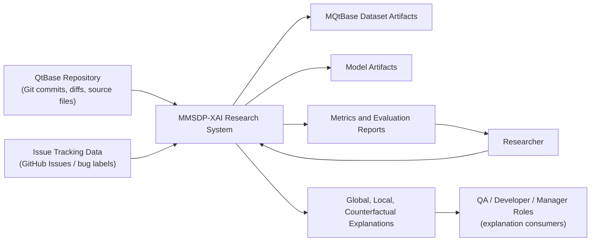
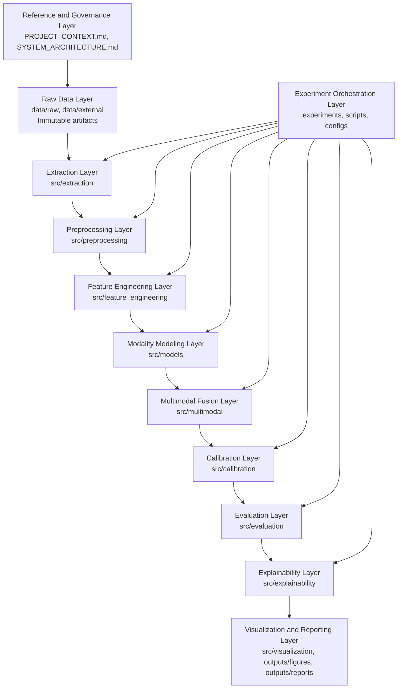
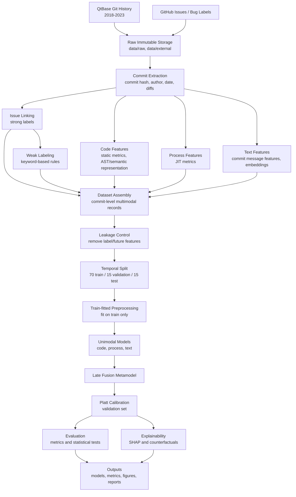
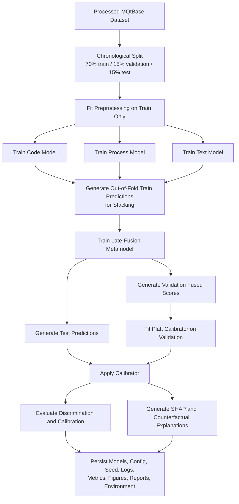

# MMSDP-XAI System Architecture

Version: 1.0

Authoritative baseline: `docs/PROJECT_CONTEXT.md` Version 2.0.

This document describes the planned architecture of MMSDP-XAI, a doctoral research framework for Multimodal Software Defect Prediction with Explainable AI. It is source-bounded: scientific claims, dataset properties, experimental protocol, and completed implementation status are taken only from `docs/PROJECT_CONTEXT.md`, the documents under `reference/`, and the current repository structure.

When information is unavailable, unresolved, or not yet fixed by the source documents, this document explicitly marks it as `PENDING DECISION` or `NOT YET SPECIFIED IN THE SOURCE DOCUMENTS`.

## 1. Purpose

The purpose of this document is to define the planned software and research architecture for MMSDP-XAI in a form suitable for doctoral research execution, reproducible experimentation, and future Q1 publication.

Following IEEE 42010 principles where applicable, the document identifies stakeholders, concerns, architectural drivers, system context, architectural views, components, interfaces, data contracts, risks, and acceptance criteria.

This document does not report completed machine learning implementation, completed experiments, final dataset statistics, or final empirical results.

## 2. Scope

The architecture covers the MMSDP-XAI research software intended to support:

- Commit-level data extraction from QtBase.
- Construction of a multimodal dataset named `MQtBase`.
- Processing of three modalities: code, process, and text.
- Temporal validation using a chronological 70 / 15 / 15 split.
- Unimodal modeling per modality.
- Decision-level late fusion.
- Post-fusion Platt Scaling.
- Global, local, and counterfactual explainability.
- Evaluation of discrimination, calibration, and interpretability.
- Reproducible experiment execution.

The architecture excludes:

- Production deployment to an industrial environment. `NOT YET SPECIFIED IN THE SOURCE DOCUMENTS`.
- User interface implementation. `NOT YET SPECIFIED IN THE SOURCE DOCUMENTS`.
- Final Q1 publication packaging. `PENDING DECISION`.
- Completed model implementation. Current repository state shows no implemented Python modules beyond placeholder directories.

## 3. Architectural Drivers

| Driver | Architectural Implication | Source Basis |
|---|---|---|
| Software defects are multifactorial | The system must integrate code, process, and text modalities. | `docs/PROJECT_CONTEXT.md`, Sections 1, 6, 20 |
| Unit of analysis is commit | Every pipeline stage must preserve commit-level identity and traceability. | `docs/PROJECT_CONTEXT.md`, Sections 6, 20, 21 |
| Temporal validity is mandatory | Splits must be chronological: 70% train, 15% validation, 15% test. | `docs/PROJECT_CONTEXT.md`, Sections 14, 21 |
| Leakage control is mandatory | Features derived from labels, future information, or non-predictive identifiers must be excluded from training. | `docs/PROJECT_CONTEXT.md`, Sections 15, 21, 23 |
| Reproducibility is mandatory | Each experiment must preserve random seed, configuration, logs, metrics, and environment. | Approved architecture requirement; `docs/PROJECT_CONTEXT.md`, Sections 15, 21 |
| Explainability is central | The architecture must include global, local, and counterfactual explanation components. | `docs/PROJECT_CONTEXT.md`, Sections 4, 8, 18, 21 |
| Calibration is central | The architecture must include post-fusion Platt Scaling and calibration metrics. | `docs/PROJECT_CONTEXT.md`, Sections 4, 14, 19, 21 |
| Repository is scaffold-only | Architecture must distinguish planned components from implemented components. | Current repository state |

## 4. Scientific Objectives

The architecture supports the following source-defined scientific objectives:

1. Design and implement a modular MMSDP-XAI architecture with data acquisition, modality-specific preprocessing, unimodal modeling, decision-level late fusion, post-hoc calibration, and explainability layers.
2. Build a commit-level multimodal dataset from QtBase using code, process, and text modalities.
3. Evaluate MMSDP-XAI against unimodal and bimodal baselines using discrimination metrics under class imbalance.
4. Evaluate probability reliability using post-fusion Platt Scaling and calibration metrics.
5. Demonstrate global, local, and counterfactual explainability using SHAP-based mechanisms.

No experimental result is claimed in this architecture document.

## 5. System Context

MMSDP-XAI is a research software system that consumes artifacts from QtBase and related issue information, produces multimodal datasets, trains and evaluates defect prediction models, and emits reproducible artifacts for doctoral analysis.

Stakeholders and concerns:

| Stakeholder | Primary Concerns |
|---|---|
| Doctoral researcher | Scientific validity, reproducibility, traceability, thesis-paper-code alignment |
| Thesis advisors | Methodological correctness, risk control, contribution clarity |
| Future reviewers | Experimental validity, leakage prevention, reproducible protocol |
| Developers / QA engineers / managers | Interpretability and actionable explanations |

## 6. Architectural Principles

1. `PROJECT_CONTEXT.md` is the single source of truth.
2. Raw data are immutable.
3. The commit is the unit of analysis.
4. Python modules are the only production code.
5. Notebooks are exploratory only.
6. All preprocessing transformations must be fitted only on training data and then applied unchanged to validation and test data.
7. The train / validation / test split must preserve chronological order.
8. Every experiment must preserve random seed, configuration, logs, metrics, outputs, and environment information.
9. Leakage control is a first-class architectural concern.
10. Components must preserve traceability from raw artifacts to final metrics and explanations.
11. Missing or undecided architecture details must be explicitly labeled, not inferred.

## 7. Overall Architecture

The planned system is organized as a modular research pipeline:

1. Extract raw artifacts from QtBase and issue sources.
2. Construct a commit-level multimodal dataset.
3. Validate dataset quality and leakage constraints.
4. Split data chronologically into train, validation, and test sets.
5. Fit modality-specific preprocessing using training data only.
6. Train unimodal models for code, process, and text.
7. Fuse unimodal predictions using decision-level late fusion.
8. Apply Platt Scaling after fusion.
9. Evaluate discrimination, calibration, and interpretability.
10. Generate global, local, and counterfactual explanations.
11. Persist all reproducibility artifacts.

Current implementation status: planned. The repository contains the directory scaffold and documentation, but no dataset pipeline, model implementation, experiment scripts, or metrics artifacts.

## 8. Layered Architecture

Layer responsibilities:

| Layer | Responsibility | Repository Path |
|---|---|---|
| Governance | Source-of-truth decisions and architecture documentation | `docs/` |
| Raw data | Immutable raw and external data | `data/raw`, `data/external` |
| Interim data | Intermediate outputs during controlled processing | `data/interim` |
| Processed data | Final model-ready datasets and splits | `data/processed` |
| Extraction | Repository, issue, diff, source, and text extraction | `src/extraction` |
| Preprocessing | Cleaning, splitting, scaling, imputation, leakage-safe transformations | `src/preprocessing` |
| Feature engineering | Code, process, and text feature generation | `src/feature_engineering` |
| Modeling | Unimodal model definitions and training support | `src/models` |
| Multimodal fusion | Decision-level late fusion and metamodel logic | `src/multimodal` |
| Calibration | Platt Scaling and calibration utilities | `src/calibration` |
| Evaluation | Discrimination, calibration, statistical, and interpretability evaluation | `src/evaluation` |
| Explainability | SHAP global/local explanations and counterfactual generation | `src/explainability` |
| Visualization | Figures, reports, and plots | `src/visualization`, `outputs/figures`, `outputs/reports` |
| Utilities | Shared reproducibility, paths, validation, and logging helpers | `src/utils` |

## 9. Repository Architecture

The current repository scaffold is:

| Path | Architectural Role | Current Status |
|---|---|---|
| `configs/` | Configuration files for pipelines and experiments | Scaffold only |
| `data/raw/` | Immutable raw data | Scaffold only |
| `data/interim/` | Intermediate data | Scaffold only |
| `data/processed/` | Processed datasets and splits | Scaffold only |
| `data/external/` | External source artifacts | Scaffold only |
| `docs/` | Project documentation | Contains `PROJECT_CONTEXT.md`; this file is added here |
| `notebooks/` | Exploratory notebooks only | Scaffold only |
| `src/extraction/` | Extraction modules | Scaffold only |
| `src/preprocessing/` | Preprocessing modules | Scaffold only |
| `src/feature_engineering/` | Feature generation modules | Scaffold only |
| `src/multimodal/` | Late fusion modules | Scaffold only |
| `src/models/` | Unimodal model modules | Scaffold only |
| `src/calibration/` | Platt calibration modules | Scaffold only |
| `src/evaluation/` | Evaluation modules | Scaffold only |
| `src/explainability/` | SHAP and counterfactual modules | Scaffold only |
| `src/visualization/` | Plotting and visualization modules | Scaffold only |
| `src/utils/` | Shared utilities | Scaffold only |
| `tests/` | Test suite | Scaffold only |
| `scripts/` | Reproducible command-line entry points | Scaffold only |
| `experiments/` | Experiment definitions and run records | Scaffold only |
| `outputs/models/` | Trained model artifacts | Scaffold only |
| `outputs/metrics/` | Evaluation metrics | Scaffold only |
| `outputs/figures/` | Generated figures | Scaffold only |
| `outputs/reports/` | Generated reports | Scaffold only |
| `paper/` | Paper-related artifacts | Scaffold only |
| `reference/` | Authoritative source documents | Protected; must not be modified automatically |

## 10. Module Responsibilities

The table below defines planned architectural components. These are not yet implemented unless explicitly stated.

| Component | Purpose | Inputs | Outputs | Repository Path | Upstream Dependencies | Downstream Dependencies | Validation Rules | Traceability |
|---|---|---|---|---|---|---|---|---|
| Reference Governance | Preserve source decisions, terminology, risks, and architecture constraints | `reference/`, `docs/PROJECT_CONTEXT.md` | Architecture and project governance docs | `docs/` | Authoritative references | All components | Must not invent missing facts; protected sources must not be modified | Source markers in docs |
| Configuration Manager | Load experiment, dataset, model, seed, and path settings | Config files | Runtime configuration object | `configs/`, `src/utils` | Governance | All pipeline stages | Missing values must fail or be marked `PENDING DECISION` | Config version and file path |
| Raw Data Store | Store immutable raw QtBase and issue artifacts | QtBase repository data, issue data | Raw files | `data/raw`, `data/external` | External sources | Extraction | Raw files must not be overwritten | Raw artifact checksum `PENDING DECISION` |
| Commit Extraction | Extract commit identifiers, metadata, diffs, and file changes | QtBase Git history | Commit-level raw records | `src/extraction` | Raw Data Store | Feature Engineering | Exclude merge commits if following source criteria; preserve commit hash | `commit_hash` |
| Issue Linking | Link commits to bug-related issues | Commit messages, GitHub Issues | Strong labels and link records | `src/extraction` | Commit Extraction, issue data | Label Construction | Must preserve issue identifiers; label rules must be explicit | `commit_hash`, issue id |
| Text Feature Extraction | Generate commit-message text features and embeddings | Commit messages, issue text when available | Text modality features | `src/feature_engineering` | Commit Extraction, Issue Linking | Preprocessing, Text Model | Empty or short text handling must be explicit | `commit_hash` |
| Process Feature Extraction | Generate JIT process metrics | Git history, diffs | Process modality features | `src/feature_engineering` | Commit Extraction | Preprocessing, Process Model | No future data may be used | `commit_hash`, temporal cut |
| Code Feature Extraction | Generate static code and semantic code features | Source snapshots, diffs | Code modality features | `src/feature_engineering` | Commit Extraction | Preprocessing, Code Model | Snapshot timing must be documented | `commit_hash`, file path |
| Label Construction | Build binary target variable | Strong labels, weak labels | Defect-prone / clean labels | `src/preprocessing` | Issue Linking, Text Feature Extraction | Dataset Assembly | Label-derived leakage features must be removed | `commit_hash`, label rule |
| Dataset Assembly | Join modalities at commit level | Code, process, text, labels | MQtBase candidate dataset | `src/preprocessing` | Feature components | Leakage Control | Join keys must be commit-level; modality availability tracked | `commit_hash` |
| Leakage Control | Remove leakage-prone variables and validate correlations / temporal overlap | Candidate dataset | Leakage-filtered dataset | `src/preprocessing` | Dataset Assembly | Temporal Split | Remove label-derived and future-information features | Feature removal report |
| Temporal Split | Create chronological 70 / 15 / 15 train-validation-test partitions | Leakage-filtered dataset | Split datasets | `src/preprocessing` | Leakage Control | Preprocessing Pipelines | No random split; test must be most recent | `commit_hash`, split id |
| Preprocessing Pipelines | Fit transformations on training data only | Split datasets | Fitted transformers and transformed datasets | `src/preprocessing` | Temporal Split | Unimodal Models | Fit only on train; apply unchanged to validation/test | Transformer metadata |
| Code Model | Train code-only unimodal model | Code features | Code defect probabilities | `src/models` | Preprocessing Pipelines | Late Fusion | Model choice from sources: XGBoost or LightGBM; final hyperparameters `PENDING DECISION` | Model id, config, seed |
| Process Model | Train process-only unimodal model | Process features | Process defect probabilities | `src/models` | Preprocessing Pipelines | Late Fusion | Planned LSTM; simpler first implementation `PENDING DECISION` | Model id, config, seed |
| Text Model | Train text-only unimodal model | Text features | Text defect probabilities | `src/models` | Preprocessing Pipelines | Late Fusion | Planned CodeBERT; embedding-only fallback `PENDING DECISION` | Model id, config, seed |
| Late Fusion Metamodel | Combine unimodal probabilities | Code, process, text probabilities | Fused raw probability | `src/multimodal` | Unimodal Models | Calibration | Decision-level late fusion; out-of-fold training required by source plan | Metamodel config |
| Platt Calibrator | Calibrate fused probabilities | Validation fused scores | Calibrated probabilities | `src/calibration` | Late Fusion | Evaluation, Explainability | Fit on validation set only | Calibrator metadata |
| Evaluation Engine | Compute discrimination, calibration, and statistical metrics | Predictions, labels | Metrics files | `src/evaluation` | Calibration | Reports | Test set reserved for final evaluation | Metrics, split id |
| Explainability Engine | Generate global, local, and counterfactual explanations | Models, features, predictions | SHAP summaries, force plots, counterfactuals | `src/explainability` | Calibration, Evaluation | Reports | Explanation fidelity and actionability criteria `PENDING DECISION` | Commit-level explanations |
| Visualization Engine | Generate figures and plots | Metrics, explanations | Figures | `src/visualization`, `outputs/figures` | Evaluation, Explainability | Reports | Plot specifications `PENDING DECISION` | Figure metadata |
| Reporting Engine | Produce experiment reports | Metrics, configs, logs, figures | Reports | `outputs/reports` | All experiment outputs | Thesis and paper analysis | Report template `PENDING DECISION` | Run id |
| Experiment Orchestrator | Run reproducible experiments | Config, seed, datasets | Complete run artifacts | `scripts`, `experiments` | All modules | Outputs | Must preserve config, seed, logs, metrics, environment | Run manifest |
| Test Suite | Verify contracts and reproducibility rules | Source modules, fixtures | Test results | `tests` | All modules | CI / local validation | Test strategy `PENDING DECISION` | Test report |

## 11. Data Flow

## 12. Component Interfaces

Interfaces are planned contracts, not implemented APIs.

| Interface | Producer | Consumer | Contract Status |
|---|---|---|---|
| Raw commit artifact interface | Raw Data Store | Commit Extraction | `PENDING DECISION` |
| Issue artifact interface | Raw Data Store | Issue Linking | `PENDING DECISION` |
| Commit record interface | Commit Extraction | Feature Engineering, Label Construction | Required fields specified in source documents, exact schema `PENDING DECISION` |
| Modality feature interface | Feature Engineering | Dataset Assembly | Partially specified by source documents |
| Label interface | Label Construction | Dataset Assembly | Binary label specified; final schema `PENDING DECISION` |
| Split dataset interface | Temporal Split | Preprocessing Pipelines | Must include split identity and chronology |
| Transformer interface | Preprocessing Pipelines | Models | Must store train-fitted parameters |
| Prediction interface | Unimodal Models | Late Fusion | Must contain commit-level probabilities |
| Fused prediction interface | Late Fusion | Calibration | Must contain raw fused probability |
| Calibrated prediction interface | Calibration | Evaluation, Explainability | Must contain calibrated probability |
| Explanation interface | Explainability | Reports | `PENDING DECISION` |
| Run manifest interface | Experiment Orchestrator | Reproducibility and reporting | Must contain configuration, random seed, logs, metrics, environment |

## 13. Data Contracts

| Data Entity | Required Content | Contract |
|---|---|---|
| Commit record | Commit hash, message, author metadata, timestamp, changed files, change statistics | Specified conceptually; exact schema `PENDING DECISION` |
| Code modality | Static metrics and semantic code representation | 6 code features reported in source documents; exact final list `PENDING DECISION` because source documents contain draft inconsistencies |
| Process modality | JIT metrics such as lines added, lines deleted, files modified, directories affected, developer experience, recency, entropy/churn | 9 process features reported; exact final list `PENDING DECISION` |
| Text modality | Commit-message features and possible embeddings | 5 text features reported; embedding representation planned |
| Label | Binary defect-prone / clean target | Strong and weak labeling are described; final implementation `PENDING DECISION` |
| Split marker | Train, validation, or test | Mandatory chronological 70 / 15 / 15 |
| Model prediction | Commit-level probability | Must identify model, split, commit, probability |
| Calibrated prediction | Commit-level calibrated probability | Must identify calibrator and validation basis |
| Metrics record | Discrimination, calibration, and interpretability metrics | Exact output schema `PENDING DECISION` |
| Explanation record | Global, local, or counterfactual explanation | Exact output schema `PENDING DECISION` |

## 14. Dataset Lifecycle

1. Acquire QtBase and issue artifacts.
2. Store raw artifacts immutably.
3. Extract commit-level metadata, diffs, messages, and source snapshots.
4. Link commits to bug-related issues for strong labels.
5. Apply weak labeling where source-defined rules permit.
6. Extract code, process, and text modality features.
7. Assemble commit-level multimodal records.
8. Remove leakage-prone features.
9. Validate dataset consistency, completeness, temporal ordering, and leakage controls.
10. Create chronological train / validation / test splits.
11. Store processed datasets with metadata and traceability.

Dataset lifecycle decisions not yet finalized:

- Exact raw storage format: `PENDING DECISION`.
- Exact processed schema: `PENDING DECISION`.
- Handling of partially missing modalities: source documents describe late-fusion handling, but implementation contract is `PENDING DECISION`.
- Final authoritative dataset size: `PENDING DECISION` due to source inconsistencies.

## 15. Configuration Management

Configuration must support:

- Dataset source and date range.
- Modalities enabled.
- Feature lists.
- Temporal split settings.
- Random seed.
- Model choices and hyperparameters.
- Calibration settings.
- Evaluation metrics.
- Output paths.
- Environment capture.

The source documents specify tool families and versions, but no repository configuration schema exists yet.

Configuration file format: `PENDING DECISION`.

Configuration validation rules: `PENDING DECISION`.

## 16. Experiment Reproducibility

Every experiment must preserve:

- Random seed.
- Configuration file.
- Code version or repository commit.
- Dataset version or dataset manifest.
- Split manifest.
- Fitted preprocessing parameters.
- Model artifacts.
- Calibration artifacts.
- Logs.
- Metrics.
- Figures and reports.
- Environment information.

Current repository status: no experiment orchestration implementation exists.

Reproducibility manifest format: `PENDING DECISION`.

## 17. Leakage Prevention Strategy

Leakage prevention is mandatory and must include:

1. Chronological splitting before final model evaluation.
2. No fitting of preprocessing transformations on validation or test data.
3. Removal of label-derived features, including weak-label keyword indicators used to construct labels.
4. Removal of future-information variables.
5. Retention of commit hash and exact timestamp only for traceability and partitioning, not for model training.
6. Validation of feature-label correlation thresholds where specified by the source plan.
7. Inspection of temporal distributions to confirm no partition overlap.

Leakage reports must be stored with experiment outputs. Exact report schema: `PENDING DECISION`.

## 18. Explainability Architecture

The explainability architecture consists of:

- Global explanations: feature and modality importance using SHAP summaries.
- Local explanations: instance-level force plots or equivalent SHAP decomposition.
- Counterfactual explanations: minimal realistic changes that would alter the prediction.

Planned explanation consumers include developers, QA engineers, and project managers.

Repository placement:

- Core explanation logic: `src/explainability`.
- Explanation figures: `outputs/figures`.
- Explanation reports: `outputs/reports`.

Exact counterfactual algorithm: `PENDING DECISION`. Source documents mention gradient-based or restricted random/local search alternatives.

Dashboard or IDE integration: `NOT YET SPECIFIED IN THE SOURCE DOCUMENTS` for this repository.

## 19. Calibration Architecture

Calibration is post-fusion Platt Scaling. The calibrator is trained on validation-set outputs of the late-fusion metamodel and then applied to the test set.

Calibration outputs:

- Raw fused probability.
- Calibrated probability.
- Calibration parameters.
- ECE.
- MCE.
- Reliability diagram data.

Repository placement:

- Calibration logic: `src/calibration`.
- Calibration metrics: `outputs/metrics`.
- Calibration figures: `outputs/figures`.

Exact Platt implementation API: `PENDING DECISION`.

## 20. Evaluation Architecture

Evaluation dimensions:

- Discrimination: AUC-ROC, AUC-PR, precision, recall, F1-score, and MCC where applicable.
- Calibration: ECE, MCE, Brier Score, and reliability diagrams where applicable.
- Interpretability: SHAP global importance, local force plots, and counterfactual examples.
- Statistical comparison: Wilcoxon paired tests and bootstrap confidence intervals with 1,000 replicas, as described in the project plan.

Evaluation must compare:

- Code-only model.
- Process-only model.
- Text-only model.
- Bimodal configurations.
- Full multimodal MMSDP-XAI.

Exact acceptance thresholds beyond calibration expectations in the source plan: `PENDING DECISION`.

## 21. Traceability Strategy

Traceability must connect:

- Source artifact to raw record.
- Raw record to commit hash.
- Commit hash to modality features.
- Modality features to assembled dataset row.
- Dataset row to split assignment.
- Split assignment to fitted preprocessing parameters.
- Preprocessed features to model prediction.
- Unimodal predictions to fused prediction.
- Fused prediction to calibrated prediction.
- Calibrated prediction to metrics and explanations.
- Experiment outputs to configuration, seed, logs, and environment.

Primary traceability key: `commit_hash`.

Secondary traceability keys: `PENDING DECISION`.

## 22. Logging Strategy

Logging must capture:

- Run identifier.
- Timestamp.
- Configuration path and configuration content hash.
- Random seed.
- Dataset manifest.
- Split manifest.
- Stage start and end.
- Validation checks.
- Leakage checks.
- Errors and warnings.
- Output artifact paths.

Logging framework: `PENDING DECISION`.

Log format: `PENDING DECISION`.

Log retention policy: `NOT YET SPECIFIED IN THE SOURCE DOCUMENTS`.

## 23. Error Handling

The planned error-handling policy is:

- Fail fast when required configuration is missing.
- Fail fast when raw data immutability is violated.
- Fail fast when train / validation / test chronology is invalid.
- Fail fast when preprocessing is fitted outside training data.
- Fail fast when leakage validation fails.
- Mark missing optional modality data explicitly rather than silently dropping commits.
- Preserve error logs for reproducibility.

Exact exception hierarchy: `PENDING DECISION`.

Recovery policies for external API failures: `PENDING DECISION`.

## 24. Extension Points

Supported conceptual extension points:

- Additional modalities, because the paper draft states the system is modular and can incorporate additional modalities.
- Alternative unimodal algorithms, provided the experiment remains reproducible and comparable.
- Alternative metamodels, because the paper draft mentions logistic regression as default and limited-depth XGBoost as a possible replacement.
- Additional calibration methods for future comparison, although the approved architecture uses Platt Scaling.
- Additional explainability methods, although the approved architecture uses SHAP-based global/local explanations and counterfactual explanations.

Any extension must preserve:

- Commit-level traceability.
- Temporal validation.
- Leakage controls.
- Reproducibility artifacts.
- Explicit comparison against approved baseline decisions.

## 25. Risks

| Risk | Impact | Architectural Mitigation |
|---|---|---|
| Data leakage | Invalid or optimistic results | Mandatory temporal split, feature filtering, train-only fitting |
| Dataset inconsistency | Misalignment between thesis, paper, and code | Dataset manifest and explicit pending decision on final dataset statistics |
| Class imbalance | Misleading accuracy | Use AUC-PR, recall, precision, F1, and related imbalance-aware metrics |
| Overfitting | Poor generalization | Validation set, early stopping where applicable, stacking out-of-fold predictions |
| LSTM / CodeBERT first-implementation complexity | Delays or unstable early implementation | Mark simpler first implementation as `PENDING DECISION`; do not claim implementation |
| Source-document inconsistency | Conflicting architecture assumptions | Treat `PROJECT_CONTEXT.md` as SSOT and document inconsistencies |
| Reproducibility gaps | Non-replicable experiments | Preserve configuration, seed, logs, metrics, environment, and artifacts |
| Missing exact schemas | Ambiguous implementation | Maintain data contracts as pending until implemented |

## 26. Pending Decisions

The following decisions remain unresolved:

1. Final authoritative dataset name if `MQtBase` vs `MQtDbase` must be reconciled.
2. Final authoritative dataset size.
3. Exact raw data storage format.
4. Exact processed dataset schema.
5. Exact configuration file format.
6. Exact logging framework and log schema.
7. Exact run manifest schema.
8. Exact model artifact format.
9. Exact metric output schema.
10. Exact explanation output schema.
11. Exact test strategy.
12. Exact first-implementation algorithms if LSTM and CodeBERT are deferred.
13. Exact counterfactual generation algorithm.
14. Exact dashboard, UI, or IDE integration scope.
15. Exact acceptance thresholds for non-calibration metrics.

## 27. Acceptance Criteria

The architecture will be acceptable when:

1. `docs/SYSTEM_ARCHITECTURE.md` exists and does not modify protected files.
2. All architecture claims are consistent with `docs/PROJECT_CONTEXT.md` Version 2.0 or explicitly marked as `PENDING DECISION` / `NOT YET SPECIFIED IN THE SOURCE DOCUMENTS`.
3. The mandatory approved decisions are represented: commit unit, MQtBase, QtBase, code/process/text modalities, decision-level late fusion, Platt Scaling, global/local/counterfactual explainability, chronological 70 / 15 / 15 split, immutable raw data, train-only preprocessing fit, reproducibility, Python production modules, and exploratory-only notebooks.
4. The document contains Mermaid diagrams for system context, layered architecture, complete data flow, and training pipeline.
5. Every planned architectural component is represented in the component responsibility table.
6. The document clearly separates planned architecture from current implementation status.
7. The document defines leakage prevention, reproducibility, traceability, calibration, explainability, and evaluation architecture.
8. Protected paths remain unchanged: `docs/PROJECT_CONTEXT.md`, `README.md`, and `reference/`.

## Training Pipeline Diagram

